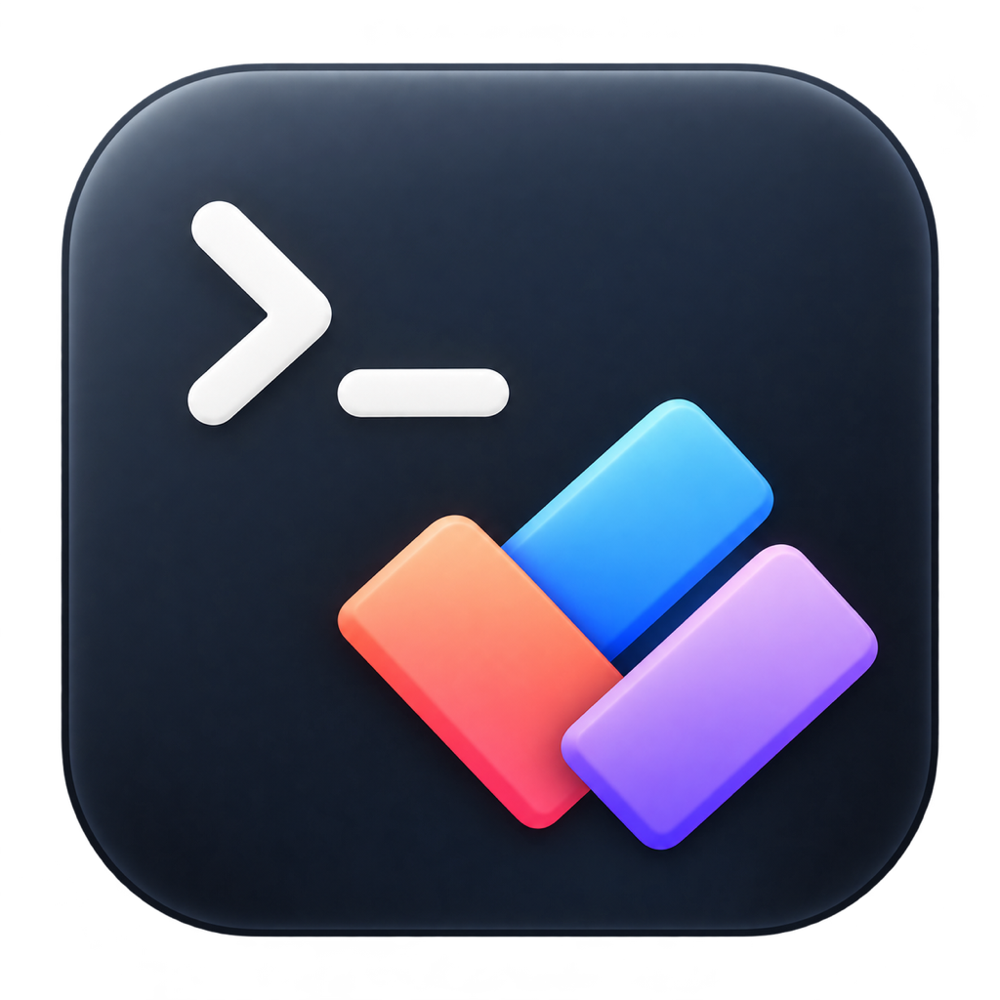
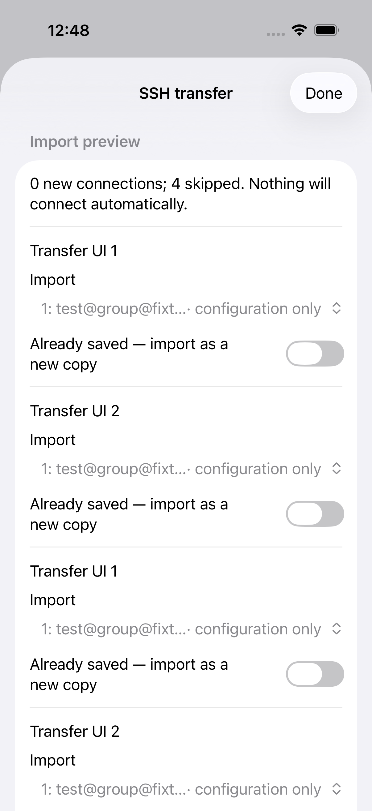
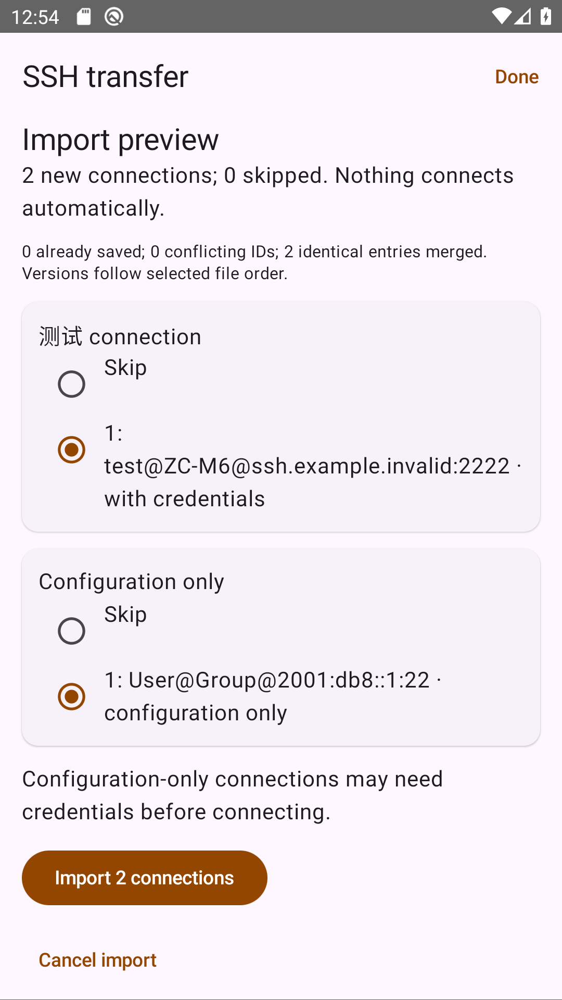
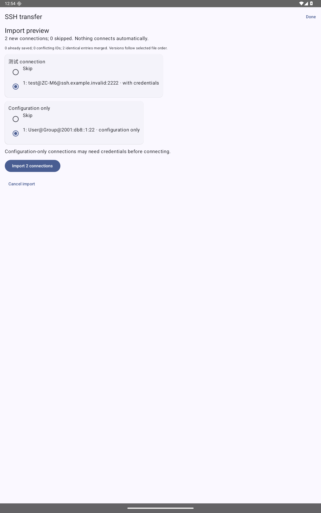

[**English**](README.md) | [简体中文](README_CN.md)

<p align="center">
  
</p>

<h1 align="center">ModernTerm</h1>
<p align="center">SSH terminals, Linux monitoring, and SFTP in a mobile workspace</p>
<p align="center">SwiftUI · Kotlin / Material 3 · iOS / iPadOS 17+ · Android 10+ · MIT</p>

ModernTerm brings remote terminals, server monitoring, and file operations into one mobile workspace. It is designed for developers and system administrators who need to check servers, run commands, edit configuration files, or transfer files while away from their computers. The iOS and Android apps use native interfaces and exchange connection profiles through encrypted `.term` files.

**Current version: 0.2.4 (build 7).** The project is actively evolving. See the verification scope and known limitations below.

[Download](https://github.com/liaoweiyang2017/ModernTerm-iOS/releases/tag/v0.2.4) · [Quick start](#quick-start) · [Build from source](#build-from-source) · [Report an issue](https://github.com/liaoweiyang2017/ModernTerm-iOS/issues) · [Modernterm for desktop](https://github.com/liaoweiyang2017/Modernterm)

## Why ModernTerm

- **One connection, three ways to work.** Switch between Monitor, Terminal, and SFTP as needed. Monitoring does not require opening an interactive terminal first.
- **Interfaces that fit each platform.** iPhone and iPad use SwiftUI and UIKit. Android uses Kotlin, Jetpack Compose, and Material 3, with large-screen layouts and dynamic colors on Android 12+.
- **Connection profiles that move with you.** Select multiple SSH connections, export a fully encrypted `.term` file, and share it through WeChat, email, or the system share sheet. Import it on the other platform using the file password.
- **No monitoring agent to install.** Read Linux system information over an existing SSH connection. GPU and Docker metrics appear when the required tools and permissions are already available.
- **Credentials stay local.** iOS uses Keychain; Android uses Keystore to protect credentials. No project account or developer-operated cloud sync service is required. Android does not require Google Play Services.
- **Straightforward to maintain.** The two platform projects share the file format, test vectors, palettes, and monitoring scripts. Requirements and acceptance records live alongside the source. Project-owned code is MIT-licensed.

## Features

| Capability | iOS / iPadOS | Android |
| --- | --- | --- |
| Interactive SSH terminal, up to 8 sessions | SwiftTerm / UIKit | Bundled xterm.js / WebView |
| Passwords, RSA / Ed25519 private keys, key passphrases | Supported | Supported |
| RSA-SHA2 host signatures and SHA-256 fingerprint confirmation | Supported | Supported |
| Connection search, favorites, editing, and group information | Supported | Supported |
| SFTP browsing, upload, download, deletion, and UTF-8 editing | Supported | Supported |
| Linux monitoring, trend charts, and multi-session overview | Supported | Supported |
| Saved commands and optional OSC 7 directory following | Supported | Supported |
| 18 terminal palettes and Ubuntu Neo automatic light/dark theme | Supported | Supported |
| Multi-select `.term` export, batch import, and system sharing | Supported | Supported |
| Open `.term` files from other apps | System document association; see LiveContainer notes below | System Open with and share intents |
| Local credential protection | Keychain | Android Keystore |

The app interface is currently primarily in English. Desktop and mobile projects are released separately; this repository does not contain Windows or macOS installers.

## Screenshots

These import previews use synthetic test data to demonstrate phone and tablet layouts. They contain no real server credentials.

| iOS | Android phone |
| --- | --- |
|  |  |

<details>
<summary>Android tablet preview</summary>



</details>

## Download and installation

Download the files from the [v0.2.4 Release](https://github.com/liaoweiyang2017/ModernTerm-iOS/releases/tag/v0.2.4):

| File | Purpose |
| --- | --- |
| `ModernTerm-Android-0.2.4.apk` | Installer for Android 10+ |
| `ModernTerm-iOS-0.2.4.ipa` | iOS / iPadOS package requiring appropriate signing or LiveContainer |
| `SHA256SUMS.txt` | SHA-256 checksums for the packages |
| `build-info.txt` | Source commit, version, and build information |

### Android

Download the APK and open it with the system installer. On first installation, you may need to allow the downloading app to install software. Later releases signed with the same key can update the existing installation. Debug builds use a separate package name and do not share Release data. A working Android System WebView is required; terminal resources are bundled with the app and are not loaded from a CDN.

**Huawei / HarmonyOS:** Only systems that can still install and run Android APKs are supported in principle. The Android 10 minimum does not imply compatibility with every HarmonyOS device. Native HarmonyOS/HAP is outside this project's scope, and Mate 70 has not been validated on physical hardware.

### iOS / iPadOS

- **Install with Xcode:** Build from source, select your own Apple Development Team, and sign the app as required by your device.
- **LiveContainer:** Import the IPA into LiveContainer. When updating, replace the existing ModernTerm app and verify that it uses the original data container. Do not delete the original container to troubleshoot an update.
- The Release IPA is not an App Store package and cannot be installed as a standalone unsigned app. Signing validity and LiveContainer maintenance depend on your installation method.

## Quick start

1. Tap **Add server** and enter Host, Port, and Username. Use a domain name or IP address for Host and enter the username separately. An `@` within a username is preserved.
2. Choose password or private-key authentication and save the connection.
3. On first connection, verify the server's **SHA-256 host fingerprint** before trusting it. The app rejects a changed saved fingerprint; investigate the change before proceeding.
4. Switch between **Monitor / Terminal / SFTP**. The terminal provides an auxiliary bar with Tab, Esc, Ctrl, and arrow keys.
5. Use **Overview** to view open connections, and adjust themes, fonts, and monitoring intervals in settings.

Connections close when the app goes into the background. Reconnect manually when you return. System file operations may have a bounded grace period, but permanent background connections are not supported.

## Encrypted connection bundles

### Export or share

1. Open **SSH transfer** from the top toolbar. Select one or more saved connections, or select all.
2. Only connection settings are exported by default. Optionally include saved passwords, private keys, and key passphrases.
3. Enter a separate file password twice, using at least 12 characters.
4. Choose **Export N connections** to save a file, or **Share N connections** to open the system share sheet and choose WeChat or another installed app.

The entire `.term` file is encrypted, including hosts, usernames, and any included credentials. The file password is not sent with the attachment; communicate it to the recipient separately. Forgotten file passwords cannot be recovered. Closing the share sheet does not confirm delivery.

### Receive a `.term` file

- **Android:** In WeChat or a file manager, choose **Open with → ModernTerm**, or select ModernTerm from the system share sheet.
- **Native iOS installation:** Select ModernTerm from the file's system open/share options.
- **iOS with LiveContainer:** Choose **Share → More → LiveContainer → ModernTerm**. The system recognizes the host app, so this additional step is required.

Enter the file password, review **Import preview**, and confirm the import. You can also select multiple `.term` files within the app for batch processing.

A batch supports up to 20 files, 16 MiB in total, and 200 connections. Existing UUIDs are skipped by default, with an option to import a new copy. Conflicting versions require an explicit choice; existing connections are not automatically overwritten. Cancelling leaves connections unchanged, and importing never connects to a server automatically. Host trust records are not transferred, so fingerprints must still be confirmed on first connection.

The format uses AES-256-GCM and PBKDF2-HMAC-SHA256 with 600,000 iterations. File passwords are normalized to NFC. See [shared/term-transfer](shared/term-transfer/README.md) for the format and synthetic cross-platform test vectors.

## Monitoring and file operations

**Linux monitoring** covers CPU/logical cores, load, memory/swap, filesystem capacity, disk throughput/IOPS, network traffic/TCP, available temperature sensors, and NVIDIA, Docker, and process statistics when permissions allow. Trend charts retain the latest 60 samples in memory, with selectable 5/10/30-second intervals. Non-Linux hosts may display only platform information.

**SFTP** supports directory browsing, file upload/download, multi-select deletion, and UTF-8 editing up to 2 MiB. Uploads do not overwrite existing destinations. Editing checks the original content and replaces the file through a temporary file, but a race remains between comparison and replacement; it is not a multi-user transaction. Non-empty directories are protected. Recursive transfers and resumable transfers are not supported.

## Security and privacy

- iOS credentials use Keychain with `WhenUnlockedThisDeviceOnly`; Android credentials are protected using Keystore and stored separately from ordinary connection settings.
- SSH requires first-use fingerprint confirmation and rejects changed fingerprints. RSA-SHA2 host signatures are supported; `ssh-rsa` / SHA-1 host-signature fallback is not enabled.
- The app has no telemetry, developer-operated credential sync, or monitoring-data upload service. Files you deliberately share through another app are handled by that app.
- Monitoring uses existing permissions. It does not run sudo, install an agent, or change Docker group membership.
- Do not include passwords, private keys, file passwords, real connection exports, or unredacted screenshots in logs or issues.
- Keys and `.term` files in the test directories are synthetic and must not be used for real servers.

## Known limitations and troubleshooting

- No local shell, SSH tunnels, automatic reconnection, permanent background operation, recursive SFTP, or workspace restoration.
- GPU/Docker metrics depend on existing remote tools and permissions. Process CPU usage is a lifetime average. Overlapping network interfaces can double-count traffic, so these metrics are unsuitable for billing.
- OSC 7 directory following requires the remote shell to report its path. The app does not modify shell startup scripts automatically.
- **Android terminal keyboard:** Tap the fixed **Keyboard** button or tap the terminal area. Scrolling the auxiliary bar does not hide the keyboard button. Version 0.2.4 fixes size updates being lost before SSH channel creation, reducing column wrapping in full-screen programs such as `top`. ColorOS 17 still requires testing on actual devices.
- **iOS keyboard does not appear:** Device Hub preview on a computer can put iOS into an external-keyboard state. Quit the desktop preview, then tap the keyboard button in Terminal.
- **Light interface but dark terminal:** Select `Ubuntu Neo (Auto)` as the terminal palette. Dark and Light are fixed palettes.
- **Attachment will not open:** Finish or cancel the current transfer, then reopen the file. Check that the attachment is complete and the password is correct. With LiveContainer, use the host-app handoff described above.
- Third-party chat apps, OEM file managers, and HarmonyOS variants may behave differently. System attachment handoff has been tested on physical hardware, but end-to-end receipt through WeChat has not been verified on every platform.

## Build from source

```sh
git clone https://github.com/liaoweiyang2017/ModernTerm-iOS.git
cd ModernTerm-iOS
```

### iOS / iPadOS

You need macOS, Xcode compatible with the project's Swift dependencies, and XcodeGen. Open `ios/ModerntermIOS.xcodeproj` in Xcode. The project configuration source is `ios/project.yml`; dependency versions are locked in the project's `Package.resolved`.

```sh
brew install xcodegen
cd ios
xcodegen generate
xcodebuild -project ModerntermIOS.xcodeproj -scheme ModerntermIOS \
  -destination 'generic/platform=iOS Simulator' \
  -derivedDataPath "$HOME/Library/Caches/ModernTerm-build" \
  CODE_SIGNING_ALLOWED=YES CODE_SIGN_IDENTITY=- build
```

Configure your own signing team in Xcode for physical devices. SwiftTerm is pinned to 1.18.0. See [ios/Vendor/README.md](ios/Vendor/README.md) for the scoped Citadel/NIOSSH compatibility patches and their rationale.

### Android

From the repository root, you need JDK 17, Android SDK 36, Build Tools 35.0.0, and a working System WebView. Set `ANDROID_HOME` or configure the ignored local file `android/local.properties`.

```sh
cd android
./gradlew lintDebug testDebugUnitTest assembleDebug
```

Output is written to `android/app/build/outputs/apk/debug/`. Release builds require your own signing key; do not commit a keystore or signing passwords. See the [Android development guide](android/README.md) for terminal assets, shared-resource synchronization, and signing instructions.

## Testing and releases

**This project runs tests and builds locally, then publishes packages through GitHub Releases. It does not use GitHub Actions.** CI results in historical acceptance records describe earlier releases only.

- iOS: Run `ModerntermTests` / `ModerntermUITests` in Xcode, or use `xcodebuild test` with an available simulator.
- Android: Run JVM tests, lint, and `connectedDebugAndroidTest`. Start the [isolated SSH test server](android/README.md#integration-tests) before SSH integration tests.
- SSH/SFTP integration scripts generate disposable credentials and do not read developers' real SSH configuration or private keys.
- `.term` tests cover interoperability, incorrect passwords, data limits, deduplication/conflicts, storage recovery, and system file handoff. Passing simulator tests does not prove compatibility with every physical device.

[0.2.4 release acceptance](specs/008-public-release/validation.md) · [Physical-device attachment checks](specs/007-open-term-attachment/validation.md) · [Cross-platform format acceptance](specs/004-term-transfer/validation.md)

## Repository structure

```text
ios/                     SwiftUI / UIKit app and Xcode project
  Sources/               SSH/SFTP, monitoring, and connection transfer
  Resources/             iOS assets, palettes, and third-party notices
  Tests/, UITests/       iOS unit and UI tests
  Scripts/               iOS integration tests and resource-generation tools
  Vendor/                Pinned Swift SSH dependencies and compatibility patches
  project.yml            XcodeGen configuration
android/                 Kotlin / Compose app and local build scripts
shared/                  Cross-platform format vectors, icons, and shared resources
specs/                   Requirements, plans, tasks, and acceptance records
```

Older acceptance records may use paths from before the platform split; iOS-specific paths now live under `ios/`. The `shared/` and `specs/` directories remain at the repository root.

## Contributing and feedback

Reproducible issue reports and focused pull requests are welcome. Include your platform, OS version, app version, installation method, reproduction steps, and expected behavior, with redacted logs. For new features, describe requirements and boundaries before proposing a minimal implementation. Preserve native platform interactions and avoid adding a large framework for a single feature. Run the relevant tests and update acceptance records before submitting changes.

## License and acknowledgments

Project-owned code is released under the [MIT License](LICENSE), permitting use, modification, and commercial distribution with the copyright and license notice retained. Third-party dependencies and assets remain subject to their respective licenses.

Thanks to SwiftTerm, Citadel, SwiftNIO/NIOSSH, Swift Crypto, SSHJ, Bouncy Castle, xterm.js, AndroidX/Compose, and the palette projects. See the [iOS third-party notices](ios/Resources/ThirdParty.txt), [Android third-party notices](android/app/src/main/assets/licenses/NOTICE.txt), [terminal license](android/app/src/main/assets/terminal/XTERM-LICENSE), and [icon provenance](shared/branding/README.md).
