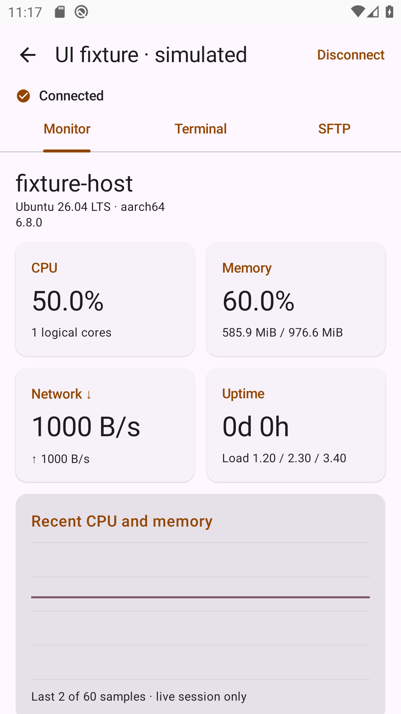
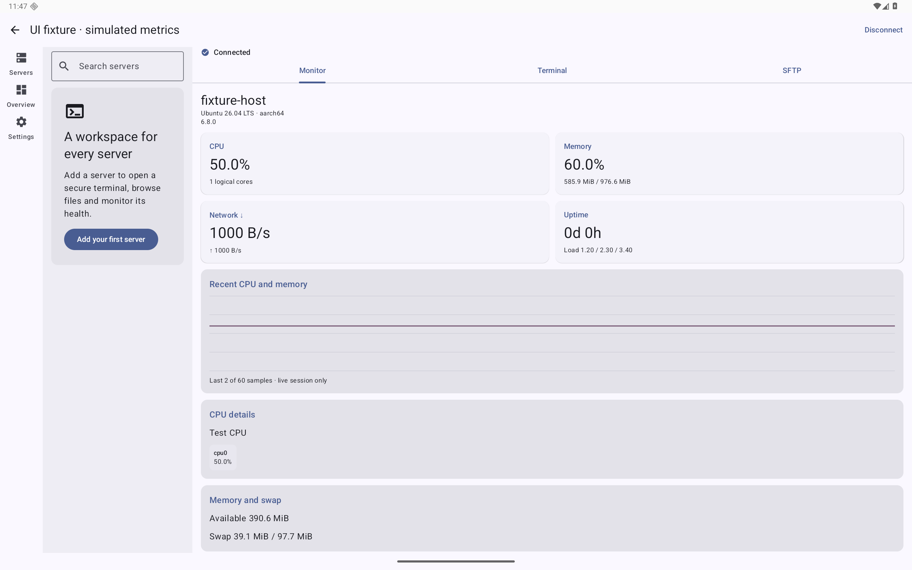

# Android 0.2.3 (5) — acceptance evidence

Started: 2026-10-17; final validation: 2026-10-18, Europe/Copenhagen. Product sources are Kotlin/Compose Material 3 in android/. No iOS product sources or Xcode project were changed by this port.

## Local results

- Android 10 / API 29 ARM64 phone emulator, WebView 91: final local suite has 12 instrumented test methods and 6 JVM test methods, zero failures; lintDebug passes.
- Android 16 / API 36 ARM64 tablet emulator, WebView 133: all 12 instrumented test methods passed, including large-screen navigation, IME and physical-display rotation. Android16 ignores application-requested orientation on large screens, so the test rotates the disposable emulator display and restores settings afterwards.
- Stock WebView compatibility: terminal bundle transpiled to Chrome 70 syntax. Cloud API29/WebView74 exposed missing ParentNode.replaceChildren; a DOM-only fallback was added. The local test explicitly removes the native method, verifies string arguments stay text nodes, and then exercises IME and VT alternate-screen rendering through the fallback.
- Release APK: versionName 0.2.3, versionCode 5, minSdk29, targetSdk36, package com.modernterm.android. Fixed 3072-bit release signing identity, APK v2 signature verified. No debug flag, test fixtures or signing secrets in the APK.
- APK installed and cold-launched on the API29 emulator. Zip alignment and all included ELF LOAD alignments support 16 KiB pages (static checks, not a physical 16 KiB device claim).
- iOS-owned palettes/monitor script consistency check passes. Kotlin source formatted with ktfmt; app-owned git whitespace check passes.

## Acceptance matrix

| ID | Evidence / qualification |
|---|---|
| A01 | APK metadata checked; API29 local installation and startup passed. Cloud API29/36 final outcome recorded below. No GMS SDK dependency in the app. |
| A02 | Real temporary SSH server: exact @ username, password success/rejection, RSA/Ed25519 OpenSSH keys including encrypted forms, on Android ART. |
| A03 | Direct untrusted host rejected; stored fingerprint change refuses without prompting to trust; legacy-only SHA-1 host server rejected. Credentials encrypted with Android Keystore and excluded from APK. |
| A04 | Native InputConnection composing/commit produces 中文 once; VT alternate-screen/ANSI output asserted; actual SSH output rendered; viewport remains nonzero with IME open; buffered output appears once. Copy-all/paste controls are implemented; OEM input-method variants remain untested. |
| A05 | SFTP upload/read/save/conflict/delete against real fixture; rejected subsystem completes within timeout and leaves PTY usable. SAF upload/download/share and UTF-8 editor are implemented. Vendor-specific document providers and large-transfer stress have not been validated on hardware. |
| A06 | Parser expectations match iOS golden inputs: CPU excluding guest double-count, remote uptime deltas, reset/reboot, memory, interfaces, filesystems, IO, TCP, GPU, Docker, processes and temperature. Linux collection is exercised in CI; local macOS fixture correctly reports unsupported monitoring. No real GPU/Docker machine validation claimed. |
| A07 | Native Material3 list/FAB/sheet/tabs/settings, portrait and landscape screenshots; theme/terminal palette behavior in code. Large-screen navigation layout implemented and tested on the API36 tablet emulator. Physical tablets, accessibility services and all enlarged-font/device combinations are not claimed as tested. |
| A08 | Eight-session limit, background cancellation, activity recreation while connected, bounded input buffering and connection-generation checks. File-picker grace period is capped at 60 seconds; no foreground/background daemon. Android vendor battery policies remain untested. |
| A09 | v1 import uses UUID validation, duplicate/version/size validation, preserved existing entries and encrypted credentials; idempotence and corrupt-config protection tested. Macros and matched-host OSC7 are implemented; source migration files are retained. |
| A10 | Dedicated API29/36 Actions pipeline, JVM tests/lint/build/device tests and signed-release job. Account artifact quota currently blocks uploads; logs and step summaries remain available. Final run listed below. |
| A11 | No Mate70 or other Huawei hardware was available. HarmonyOS4.3/NEXT5+ and 卓易通 compatibility are explicitly NOT marked verified. |
| A12 | Installable fixed-signature APK produced, SHA256 and build-info provided; signing identity remains outside Git and in repository Secrets. Private repository Release is used for download because Actions artifact storage is full. |

## Reproduced issues and corrections

1. API29 cloud WebView74 could not parse newer JS syntax / lacked replaceChildren. Bundle syntax lowered and a narrow DOM fallback added; no weakened host verification or external CDN.
2. A WebView with wrap-content native layout could collapse to zero terminal viewport height when the IME opened. Explicit MATCH_PARENT sizing and corrected padding were validated with DOM height/rows and screenshots.
3. Pre-ready byte buffering plus session replay duplicated initial output. Live rendering now starts after ready; replay supplies the initial buffer exactly once.
4. Landscape screenshot capture hit an Espresso double-idle wait. Removed the redundant idle wait from screenshot capture; actual orientation and content assertions retained.
5. Local cloud-synced generated directories produced duplicate dex files; local build/cache moved outside Documents. CI uses normal generated paths.
6. Hosted runners ran out of disk when the emulator requested its default ~7.4 GiB userdata partition after compilation. The workflow now frees unused disposable-runner toolchains and explicitly limits emulator userdata to 3 GiB. This was an environment boot failure, not a passed device test.
7. Reconnect after transport loss left a suspended old writer able to consume the first new keystroke. An end-to-end regression reproduced the missing first input; reconnect now retires the previous generation before starting a new writer, and the regression passes on both local API levels.
8. Actions artifact quota exceeded. Upload failure is visible and isolated from build/test status; no unrelated artifacts deleted. Release attachment/local APK provides delivery.

## CI outcome

Base Android implementation CI passed on default branch commit ce00136: [run 39074704231](https://github.com/liaoweiyang2017/ModernTerm-iOS/actions/runs/39074704231), including API29 emulator, API36 emulator and signed APK jobs. Each emulator ran 12 instrumented tests; six JVM tests and lint passed. Artifact upload warnings reflect the account storage quota, not failed tests. The subsequent cross-platform .term feature and build 6 are tracked separately in specs/004-term-transfer/validation.md.

## Reproduction commands

```sh
# From repository root, with a venv containing paramiko==4.0.0:
python android/scripts/ssh_fixture.py
# From android/ in another shell, with a booted disposable emulator:
./gradlew lintDebug testDebugUnitTest connectedDebugAndroidTest
# Shared resources:
python3 scripts/sync_shared.py --check
# Fixed local release signing, from repository root:
JAVA_HOME=<JDK17> python3 android/scripts/build_release.py
```

Local logs are under ignored build/; standard CI reports are under android/app/build/. Release/debug package IDs are separate. Test screenshots use clearly labeled synthetic metrics and temporary test servers; production APKs contain neither fixtures nor preview sessions.


## Screenshots

These screenshots contain explicitly labeled synthetic metrics, not user server data.





Release signer SHA-256: `5dcca3a86795783f10d3b44eaaa2f06ddc5ed6e4bfbbd6337df7edbf4e2e1c19`. APK SHA-256 is delivered in `SHA256SUMS.txt`; the APK is not committed into Git.
